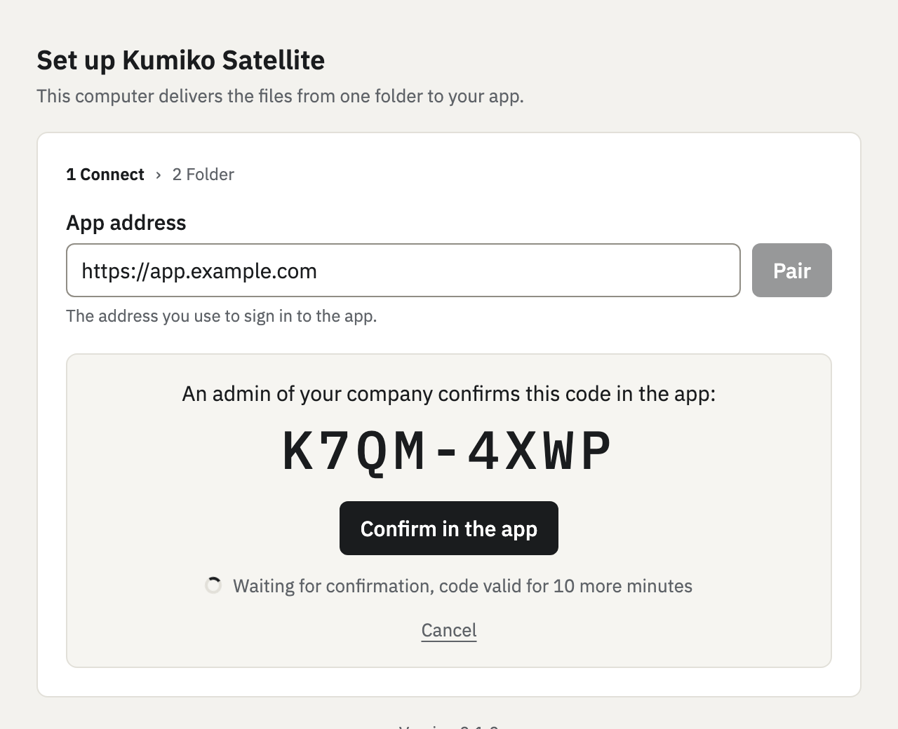
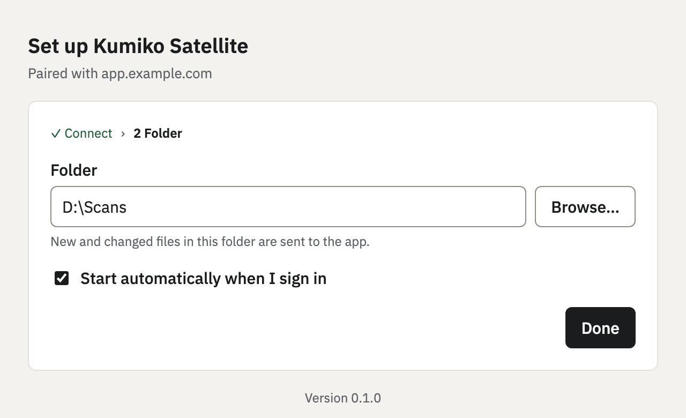
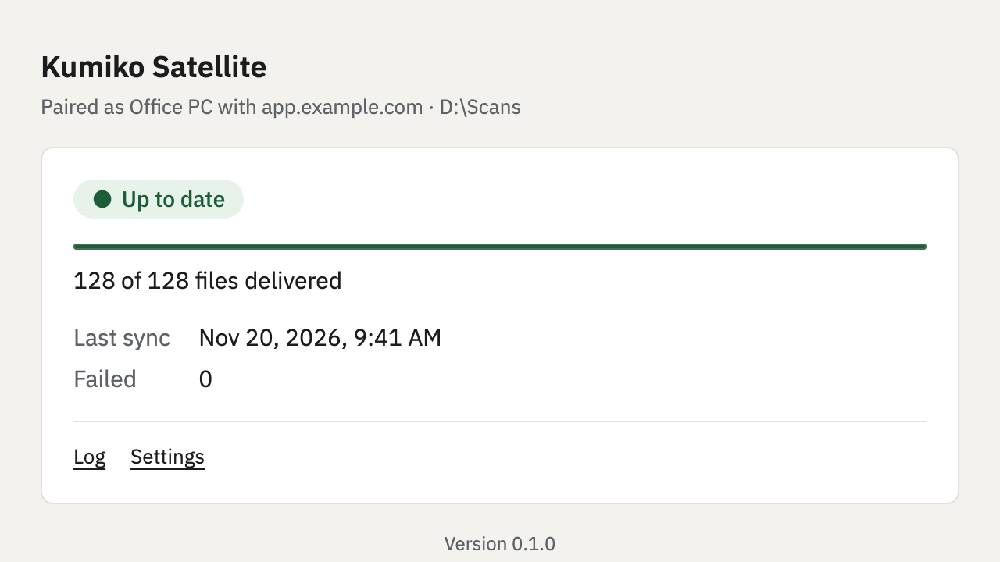

# kumiko-satellite

A small program for a customer's own machine. It watches one folder and delivers new and changed
files to a Kumiko app over HTTPS. It is the "satellite" of the connectors feature; the wire
protocol is described in the Kumiko guide `docs/guides/connectors-satellite.md`.

## Security model

- Outgoing HTTPS only. The program opens no port except the local page bound to `127.0.0.1`.
  Plain `http://` app URLs are refused unless the host is `localhost` or a loopback address.
- The device token (`ksat_...`) is stored only on this machine, in
  `os.UserConfigDir()/kumiko-satellite/config.json` with mode `0600`. The app keeps only its hash.
  An admin of the tenant can revoke the connector at any time; the satellite then shows
  "Device revoked, pair again" and stops uploading.
- The Go standard library plus two pinned modules that only draw the window (see
  [Dependencies](#dependencies)), so the code can be audited in an afternoon. Everything lives in
  `internal/` with one small package per topic.
- Folder guard: a drive or share root (`C:\`, `D:\`, `\\server\share`, `/`), Windows system folders
  (`Windows`, `Program Files`, `Program Files (x86)`, `ProgramData`, `AppData`), the user profile
  itself and Unix system folders (`/etc`, `/usr`, `/bin`, `/System`, ...) are rejected. Pick a
  dedicated folder. Symlinks are resolved for this check and never followed while scanning.
- Hidden and system files, recycle bin, `Thumbs.db`, `desktop.ini`, `.DS_Store`, `pagefile.sys`,
  `hiberfil.sys`, `swapfile.sys` and `~$` lock files are skipped, the same list the server enforces.
- Only the user who started the satellite can use the local page, also on a shared server (RDP):
  each start writes a random secret (and its PID as a hint) to `session` in the user's config dir
  (mode `0600`), and deletes the file on a clean exit. The secret is never sent: `open` and a
  second start first make the server prove it knows the secret (HMAC over a random challenge), so
  a program squatting on the recorded port gets nothing and `open` stops with "Another program is
  using the satellite's port"; then they answer a one-time challenge the same way to ask for a
  login nonce or for the window. The nonce is single-use, valid 60 s. A browser start opens a
  `login-*.html` file (mode `0600`, in the config dir) that posts the nonce to `/login`, so the
  nonce is in no command line; the file goes away with the login or after 60 s. The page answers
  401 without the random session cookie `ksat_session_<port>` that the login sets. If the default
  port is taken (for example by another user's instance) a free port is used and recorded in the
  same file. What remains: browsers share cookies between ports, so if the owner's browser is
  sent to a foreign program's port, that program can read the cookie; the satellite itself never
  opens a port other than its own.
- The local page checks the `Host` header (against DNS rebinding) and protects every button
  with a random token plus an `Origin` check. Folder dialog and `schtasks` run with fixed
  arguments only; the `ksat_` token is never shown on the page.

## Install and set up

Download the program for your computer from the
[latest release](https://github.com/CosmicDriftGameStudio/kumiko-satellite/releases/latest):

| Computer | File |
|---|---|
| Windows 10/11 (most PCs) | [`kumiko-satellite-windows-amd64.exe`](https://github.com/CosmicDriftGameStudio/kumiko-satellite/releases/latest/download/kumiko-satellite-windows-amd64.exe) |
| Windows on ARM | [`kumiko-satellite-windows-arm64.exe`](https://github.com/CosmicDriftGameStudio/kumiko-satellite/releases/latest/download/kumiko-satellite-windows-arm64.exe) |
| Mac with Apple chip (M1 and later) | [`kumiko-satellite-darwin-arm64.app.zip`](https://github.com/CosmicDriftGameStudio/kumiko-satellite/releases/latest/download/kumiko-satellite-darwin-arm64.app.zip) |
| Mac with Intel chip | [`kumiko-satellite-darwin-amd64.app.zip`](https://github.com/CosmicDriftGameStudio/kumiko-satellite/releases/latest/download/kumiko-satellite-darwin-amd64.app.zip) |
| Linux | [`kumiko-satellite-linux-amd64`](https://github.com/CosmicDriftGameStudio/kumiko-satellite/releases/latest/download/kumiko-satellite-linux-amd64), [`-linux-arm64`](https://github.com/CosmicDriftGameStudio/kumiko-satellite/releases/latest/download/kumiko-satellite-linux-arm64) |

On Windows put it in a place of its own (for example `C:\Tools`) and double-click it. The Windows
program is not signed yet: SmartScreen asks once ("More info", "Run anyway"). On a Mac move
"Kumiko Satellite" from the unpacked zip to the Applications folder and open it there; the app is
signed and notarized by Apple. On Linux the download loses its execute bit, so run
`chmod +x kumiko-satellite-*` first. A window opens
(Windows and macOS; on Linux the default browser opens instead):

1. **Connect:** enter the app address and press "Pair". A code appears; an admin of your company
   confirms it in the app ("Confirm in the app" opens the pairing screen).

   

2. **Choose folder:** pick the folder with "Browse…" (native folder dialog; on Linux needs
   `zenity`, otherwise type the path) and keep "Start automatically when I sign in" ticked.

   

Then the window shows the status, with the name the device was given in the app:

Closing the window does not stop the sync; double-click the
program again to get the window back. "Settings" on the status page changes the folder and the
autostart. After a revocation, "Pair again" runs step 1 again and keeps the folder. "Quit satellite" on the status page stops it, for example before replacing the program with a new version: put the new file in the same place under the same name and start it; pairing and folder are kept.

Autostart: Windows uses a per-user logon task (`schtasks`, no admin rights), macOS a LaunchAgent in
`~/Library/LaunchAgents`, Linux an entry in `~/.config/autostart`. The log is written next to
`state.json` (`kumiko-satellite.log`).

If WebView2 is missing or the window cannot open, the default browser opens the same page.
`kumiko-satellite open` opens it again from a terminal.

### For admins: command line

    kumiko-satellite pair --url https://app.example.com --folder "D:\Belege"
    kumiko-satellite run --folder "D:\Belege" --status-addr 127.0.0.1:8765
    kumiko-satellite version

`pair` prints a verification URL and a code such as `AB12-CD34`; an admin confirms it in the app
and the token is stored. `--folder` is optional there and can be given to `run`. The Windows exe
is built for the GUI subsystem and attaches to the parent console, so the commands print in `cmd`
and PowerShell (the prompt may return before the output ends). On a Mac the program sits in the
app: `"/Applications/Kumiko Satellite.app/Contents/MacOS/kumiko-satellite" version`.

Build from source (Windows and Linux are pure Go; macOS needs cgo for the window):

    go build -ldflags "-X main.version=1.0.0" -o kumiko-satellite ./cmd/kumiko-satellite

## How it runs

The folder is scanned every 30 seconds. A file is uploaded once its size and modification time
stayed equal over two scans, so half-written files wait ("Checking new files"). Uploads run one
after another; failures retry after 1, 5 and 30 minutes (`Retry-After` is respected). If the app's
storage is full, uploads pause until you press "Retry". A heartbeat with version and sync state
goes out every 60 seconds; if the server answers with the name this device is paired under, the
status window shows it ("Paired as Office PC with app.example.com"). Progress is remembered in `state.json` next to the config file.

## Dependencies

Everything else is the Go standard library. Two small modules draw the window, one per platform:

- `github.com/jchv/go-webview2` (Windows): hosts WebView2, which ships with Windows 10 and 11;
  no cgo, so the Windows build stays a plain cross-build.
- `github.com/webview/webview_go` (macOS): hosts the system WKWebView through cgo; the macOS
  binary is built on a Mac runner.

Both are pinned in `go.mod`. Linux builds do not use them.

## Development

    go vet ./... && go test ./...

## License

MIT, see [LICENSE](LICENSE).

The status page embeds IBM Plex Sans and IBM Plex Mono (SIL Open Font License 1.1, see
`internal/status/fonts/OFL.txt`).
